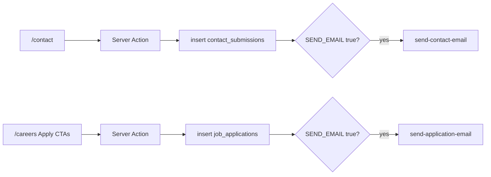

# Supabase

Contact, careers, and Rose open-source application forms submit through Next.js Server Actions to the OllyGarden Supabase project. The browser never receives the Supabase URL or key. Never put a secret / `service_role` key in this repo.

Env names are server-only (`SUPABASE_*`, no `NEXT_PUBLIC_`).

## Environment

Copy [`.env.example`](../.env.example) and set:

| Variable | Role |
| --- | --- |
| `SUPABASE_URL` | Project URL (`https://….supabase.co`) |
| `SUPABASE_PUBLISHABLE_KEY` | Publishable / anon key — stays on the server |
| `SUPABASE_SEND_EMAIL` | `true` to invoke Edge Functions after insert. Anything else (`false`, unset) **inserts only** — no mail |

On Vercel, add these as regular (or Sensitive) env vars. Do not use the `NEXT_PUBLIC_` prefix.

Restart `next dev` after changing these.

## Flows



**Contact** ([`src/components/contact-form.tsx`](../src/components/contact-form.tsx)): name, work email, optional message → Server Action → `contact_submissions` → optional `send-contact-email`.

**Careers** ([`src/components/careers-apply-cta.tsx`](../src/components/careers-apply-cta.tsx)): **Apply Now** (per open position), **Submit Open Application**, and **Submit Application** share one modal and one Server Action path. Fields: full name, email, optional LinkedIn and GitHub → `job_applications` → optional `send-application-email`.

Open positions are the `careersOpenPositions` array in [`src/lib/careers.ts`](../src/lib/careers.ts). Full content/ops docs: [`careers.md`](careers.md).

| CTA | `job_id` | `job_title` |
| --- | --- | --- |
| **Apply Now** on a listed role | that role’s `id` (e.g. `founding-enterprise-account-executive`) | that role’s `title` |
| **Submit Open Application** / interview **Submit Application** | `open-application` | `Open Application` |

With `SUPABASE_SEND_EMAIL=false`, only the insert runs. With `true`, the Edge Function receives `{ jobId, jobTitle, applicant: { fullName, email, linkedinUrl, githubUrl } }` using the same ids/titles as the insert.

If `job_id` is a UUID column in Postgres, slug inserts will fail until product provides real ids.

Job applications also collect two optional multiline answers: “Tell us something cool you built:”
and “Why do you want to become an OllyGardener?”. They are stored as nullable text in
`cool_project` and `motivation`; blank or omitted answers become `null`. Notifications receive
them as `applicant.coolProject` and `applicant.motivation`.

Before deploying this form change, an authorized Supabase operator must add the columns:

```sql
alter table public.job_applications
  add column cool_project text,
  add column motivation text;
```

This SQL has not been applied by Wicket. Without the columns, application inserts will fail,
including applications with blank answers. Update the external `send-application-email` function
to include the answers in notification emails and escape them as untrusted text if rendering HTML.
Passing the answers to the function does not guarantee its existing email template displays them.


## Client

| File | What |
| --- | --- |
| [`src/lib/supabase/client.ts`](../src/lib/supabase/client.ts) | Server-only `createClient`; skips init when URL/key are missing |
| [`src/lib/supabase/submissions.ts`](../src/lib/supabase/submissions.ts) | Server Actions: insert + gated `functions.invoke` |
| [`src/lib/supabase/types.ts`](../src/lib/supabase/types.ts) | Hand-written `Database` type from the previous app’s insert payloads, not `supabase gen types` |

Package: `@supabase/supabase-js` only. No `@supabase/ssr` (no sessions).

## Local test without mail

1. Set URL + publishable key.
2. Leave `SUPABASE_SEND_EMAIL` as `false`.
3. Submit `/contact` and the careers modal.
4. Check Table Editor: `contact_submissions` and `job_applications`.

When you want the first real notification, set `SUPABASE_SEND_EMAIL=true` and restart. That flag only skips **our** `functions.invoke`. A database trigger or webhook on insert would still fire.

## RLS

Inserts still use the publishable key (`anon`) on the server. Keep RLS tight: `anon` may insert, and must not `SELECT` other people’s rows. Policy changes live in the Supabase project, not in this repo.
