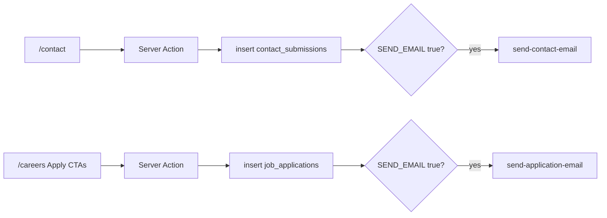

# Supabase

Contact, careers, and Rose open-source application forms submit through Next.js Server Actions to the OllyGarden Supabase project. The browser never receives the Supabase URL or key. Never put a secret / `service_role` key in this repo.

Env names are server-only (`SUPABASE_*`, no `NEXT_PUBLIC_`).

## Environment

Copy [`.env.example`](../.env.example) and set:

| Variable | Role |
| --- | --- |
| `SUPABASE_URL` | Project URL (`https://….supabase.co`) |
| `SUPABASE_PUBLISHABLE_KEY` | Publishable / anon key — stays on the server |
| `SUPABASE_SEND_EMAIL` | `true` to invoke Edge Functions after insert. Anything else (`false`, unset) **inserts only** — no mail |

On Netlify, add these as regular (or secret) env vars. Do not use the `NEXT_PUBLIC_` prefix.

Restart `next dev` after changing these.

## Flows



**Contact** ([`src/components/contact-form.tsx`](../src/components/contact-form.tsx)): name, work email, optional message → Server Action → `contact_submissions` → optional `send-contact-email`.

**Careers** ([`src/components/careers-apply-cta.tsx`](../src/components/careers-apply-cta.tsx)): **Apply Now** (per open position), **Submit Open Application**, and **Submit Application** share one modal and one Server Action path. Fields: full name, email, optional LinkedIn and GitHub → `job_applications` → optional `send-application-email`.

Open positions are the `careersOpenPositions` array in [`src/lib/careers.ts`](../src/lib/careers.ts). Full content/ops docs: [`careers.md`](careers.md).

| CTA | `job_id` | `job_title` |
| --- | --- | --- |
| **Apply Now** on a listed role | that role’s `id` (e.g. `founding-enterprise-account-executive`) | that role’s `title` |
| **Submit Open Application** / interview **Submit Application** | `open-application` | `Open Application` |

With `SUPABASE_SEND_EMAIL=false`, only the insert runs. With `true`, the Edge Function receives `{ jobId, jobTitle, applicant: { fullName, email, linkedinUrl, githubUrl } }` using the same ids/titles as the insert.

If `job_id` is a UUID column in Postgres, slug inserts will fail until product provides real ids.

Job applications also collect two optional multiline answers: “Tell us something cool you built:”
and “Why do you want to become an OllyGardener?”. They are stored as nullable text in
`cool_project` and `motivation`; blank or omitted answers become `null`. Notifications receive
them as `applicant.coolProject` and `applicant.motivation`.

The columns come from
[`20261013120000_job_applications_answers.sql`](../supabase/migrations/20261013120000_job_applications_answers.sql).
Production received them by hand on 2026-10-13, after PR #98 had shipped the form without them;
every application insert failed until then. The insert always sends both keys, so the columns must
exist before the form code deploys.

[`send-application-email`](../supabase/functions/send-application-email/index.ts) shows both
answers, when present, in the hiring email. `send-contact-email` accepts a blank message, matching
the optional `/contact` field. Both build their HTML in
[`_shared/email.ts`](../supabase/functions/_shared/email.ts), which escapes every form value and
links only http(s) URLs; `test/email-templates.test.mjs` covers it. Both return a non-2xx status
when Resend rejects the team notification, so the Server Action reports
`notification: "failed"`. A rejected applicant confirmation is only logged.

The quiz, Rose, Tulip, and waitlist functions are deployed but not called by this site. They still
interpolate input unescaped.

## Schema and Edge Functions

[`supabase/`](../supabase) is the source of truth for the existing **Website** Supabase project
(ref `sspupghymzfikfemusdc`). Do not create a new project; `project_id` in `config.toml` is only a
local Docker label.

| Path | What |
| --- | --- |
| `supabase/migrations/` | Every schema, grant, and RLS change, in order. The first eight files are copied unchanged from `ollygarden/ollygarden-com`, which owned the project before Wicket, so their versions match the remote history |
| `supabase/functions/` | The six deployed Edge Functions, downloaded from production on 2026-10-13 |
| `supabase/config.toml` | Local stack settings, Postgres major version 15 to match production, and each function's `verify_jwt` (`join-waitlist` is `false`) |

The CLI version is pinned in `package.json`; run it as `bun run supabase …`. A personal login
(`bun run supabase login`) is enough: without a database password the CLI creates a temporary
login role. `db diff` also needs Docker.

```bash
bun run supabase link --project-ref sspupghymzfikfemusdc
bun run supabase migration new <change>        # write the SQL; prefer additive changes
bun run supabase migration list --linked       # local and remote versions must line up
bun run supabase db diff --linked --schema public  # "No schema changes found" = repo matches prod
bun run supabase db push --dry-run --linked    # shows exactly what would be applied
```

### Automatic deploys

Merging to `main` runs [`deploy-production.yml`](../.github/workflows/deploy-production.yml), one
run at a time:

1. `db push` applies every pending migration in `supabase/migrations/`.
2. If anything under `supabase/functions/` or `config.toml` changed since the last run that
   deployed Supabase, every function is redeployed with its `verify_jwt`. Until one run has
   succeeded, every run deploys all functions.
3. A Netlify build hook starts the production build, with the commit as the hook body.

Netlify skips the production build a merge would start (`ignore` in `netlify.toml`), and the
production `prebuild` refuses to build without that hook body or for a different commit
(`validateProductionDeploy` in `scripts/validate-netlify-env.mjs`). So a failed migration leaves
the previous deploy live instead of publishing code against the old schema. Deploy previews still
build on every pull request. To redeploy without a merge, for example after changing a Netlify
variable, run **Deploy production** from the Actions tab; Netlify's own **Trigger deploy** is
skipped or fails in `prebuild` by design. A run for a commit that is no longer `main` HEAD cancels
itself before touching Supabase, so re-running an old run never deploys old functions. Re-running a
failed run is otherwise safe: applied migrations are skipped. A commit message with `[skip ci]`
skips the deploy too; run the workflow by hand afterwards.

If Supabase is unavailable or a migration is stuck and a code fix must ship, run **Deploy
production** with **skip_supabase** checked. It publishes `main` without migrations or functions,
so only use it when the code needs neither a pending migration nor an Edge Function update.

Pull requests that touch `supabase/` also run
[`supabase-check.yml`](../.github/workflows/supabase-check.yml): `migration list` and
`db push --dry-run` against the project, which show what the merge will apply and fail when the
project has migrations this branch does not.

Keep migrations backward compatible (new nullable columns, new tables): they apply while the
previous code is still live. Migration file names are timestamps, and `db push` refuses one older
than the newest applied migration. If another migration merged first, rename yours with a newer
timestamp (`bun run supabase migration new` makes one) before merging; **Supabase check** shows the
order, so re-run it after other migrations land. A failed `db push` is not retried; read the run log and the live
schema, and when the change is present but unrecorded, run
`bun run supabase migration repair <version> --status applied` instead of re-running the SQL.

The workflows need repository secrets `SUPABASE_ACCESS_TOKEN` (a Supabase access token whose owner
can change the Website project) and `NETLIFY_BUILD_HOOK_URL` (a build hook on `main` for
`ollygarden-wicket`). `SUPABASE_DB_PASSWORD` is optional; without it the CLI uses a temporary
login role. Values live in GitHub and the services, never in this repository.

The manual commands above still work for local checks and emergencies. A hand-applied migration
is recorded in the remote history, so the next deploy skips it. Deploy one function by hand with
`bun run supabase functions deploy <name> --project-ref sspupghymzfikfemusdc`.

This repository is the only source of the project's migrations and functions.
`ollygarden/ollygarden-com` deployed them from its `main` until 2026-10-13, when its PR #314
removed that workflow and its `supabase/` folder. Do not make database or function changes there.


## Client

| File | What |
| --- | --- |
| [`src/lib/supabase/client.ts`](../src/lib/supabase/client.ts) | Server-only `createClient`; skips init when URL/key are missing |
| [`src/lib/supabase/submissions.ts`](../src/lib/supabase/submissions.ts) | Server Actions: insert + gated `functions.invoke` |
| [`src/lib/supabase/types.ts`](../src/lib/supabase/types.ts) | Hand-written `Database` type from the previous app’s insert payloads, not `supabase gen types` |

Package: `@supabase/supabase-js` only. No `@supabase/ssr` (no sessions).

## Local test without mail

There is only one Website project, so these steps write real rows to production. Agree the test
entry with the team first, use obviously fake details, and never use a real person's data.

1. Set URL + publishable key.
2. Leave `SUPABASE_SEND_EMAIL` as `false`.
3. Submit `/contact` and the careers modal.
4. Check Table Editor: `contact_submissions` and `job_applications`.

When you want the first real notification, set `SUPABASE_SEND_EMAIL=true` and restart. That flag only skips **our** `functions.invoke`. A database trigger or webhook on insert would still fire.

## RLS

Inserts still use the publishable key (`anon`) on the server. Keep RLS tight: `anon` may insert, and must not `SELECT` other people’s rows. Policy changes are migrations in `supabase/migrations/`, not dashboard edits.
